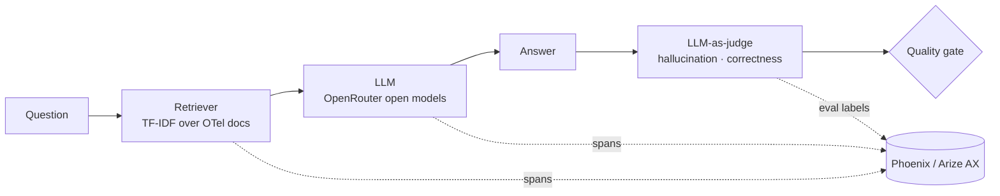
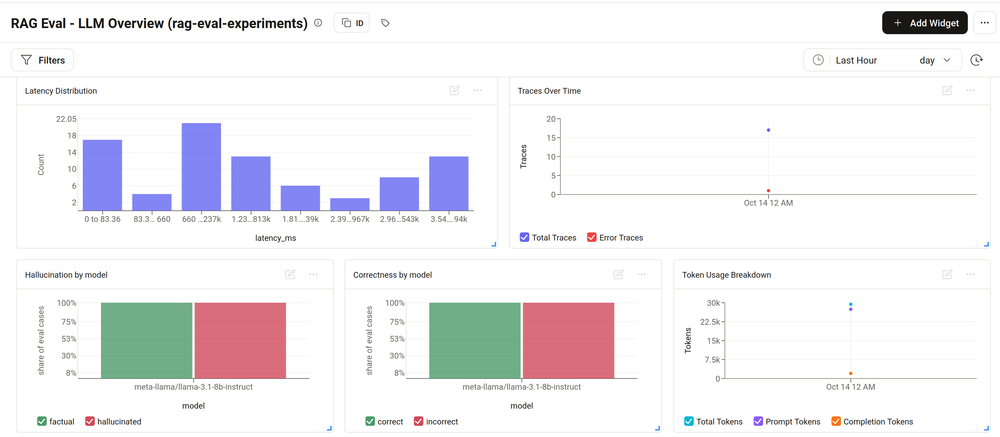
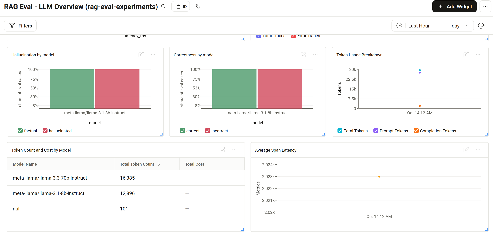
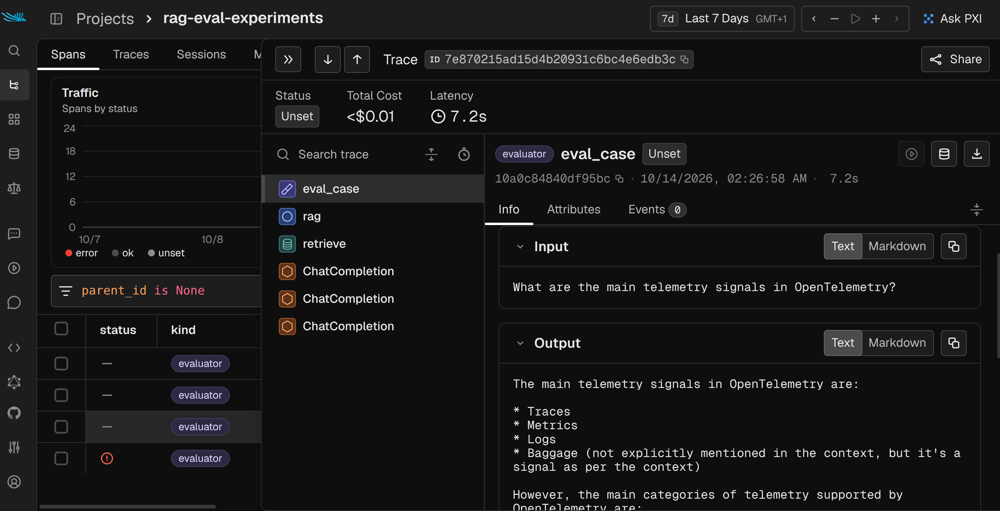
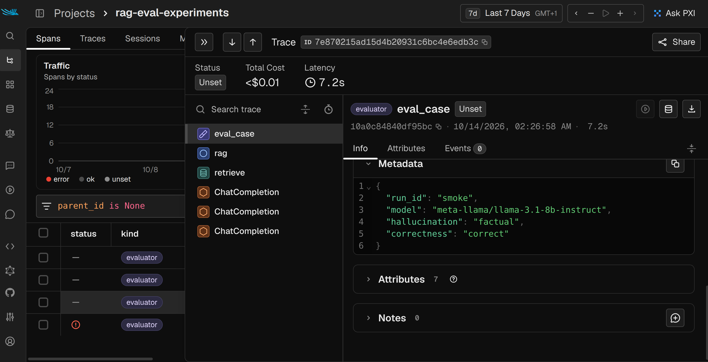
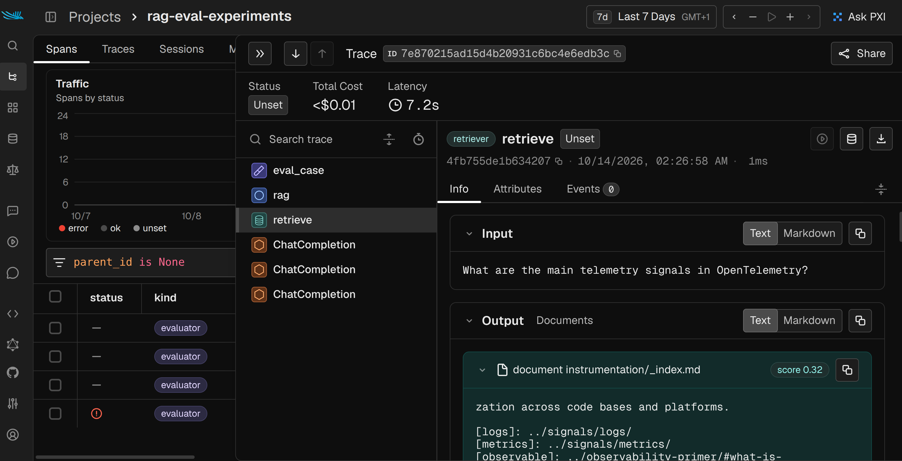

# RAG Evaluation & LLM Observability

A small RAG assistant that answers questions from the OpenTelemetry docs. It is traced end to end with OpenTelemetry/OpenInference and evaluated with an **LLM-as-judge** suite that compares open models. A **CI quality gate** blocks pull requests that increase hallucinations.

- **Tracing:** every request becomes a trace (`rag` → `retrieve` + LLM call), sent to **Phoenix** locally or to **Arize AX**.
- **Evals as code:** a golden dataset with reference answers. A larger model judges each answer for **hallucination** (is it supported by the retrieved context?) and **correctness** (does it match the reference?).
- **Model comparison:** the same golden set runs through several open models served by OpenRouter.
- **Quality gate:** `make eval` exits non-zero when the hallucination rate exceeds a threshold, and GitHub Actions runs it on every PR.
- **Dashboards:** eval labels are attached to the traces, so Arize AX dashboards can chart hallucination and correctness per model and per run.

## Architecture



Each golden question produces this trace:

```
eval_case (EVALUATOR)  metadata: run_id, model, hallucination, correctness
├── rag (CHAIN)
│   ├── retrieve (RETRIEVER)  top-4 chunks with source and score
│   └── ChatCompletion (LLM)  model, tokens, latency
├── ChatCompletion (LLM)      judge: hallucination
└── ChatCompletion (LLM)      judge: correctness
```

## Results

<!-- EVAL_TABLE_START -->
_Run `make eval && make readme` to fill in this table._
<!-- EVAL_TABLE_END -->

## Observability dashboard (Arize AX)

The dashboard is created as code through the Arize GraphQL API (`dashboards/arize_dashboard.py`, idempotent):

```bash
make dashboard PROJECT=rag-eval-experiments
```

It adds traces over time, span latency, latency distribution, token usage and average eval scores.





_These screenshots come from a partial baseline run: 17 golden questions on `llama-3.1-8b-instruct`, judged by `llama-3.3-70b-instruct`. The run stopped when the API credits ran out, which is the one error trace shown. The full 3-model comparison fills the same charts._

## Traces (Phoenix)

Each golden question is one trace. The `eval_case` span holds the question, the answer and the judge labels. Its children are the RAG chain, the retrieval and the 3 LLM calls (answer and 2 judge calls).



The judge labels are stored as span metadata, which Phoenix and Arize use to filter and chart by model and run:



The retriever span shows the retrieved chunks with their source file and similarity score:



## Quick start

```bash
python3 -m venv .venv && .venv/bin/pip install -r requirements.txt
cp env.example .env          # add your OPENROUTER_API_KEY
make test                    # offline unit tests
make docs                    # download the OpenTelemetry concept docs (corpus)
make phoenix                 # Phoenix UI on http://localhost:6006
make ask Q="What is a span?"
make eval                    # golden set x models -> results/summary.md
make readme                  # copy the results table into this README
```

Useful variables:

| Variable | Default | Purpose |
|---|---|---|
| `TRACING_BACKEND` | `phoenix` | `phoenix`, `arize` or `none` |
| `EVAL_MODELS` | Llama 3.1 8B, Qwen 2.5 7B, Mistral 7B | Comma-separated OpenRouter model ids |
| `JUDGE_MODEL` | `meta-llama/llama-3.3-70b-instruct` | Model that grades the answers |
| `MAX_HALLUCINATION` | `0.10` | Gate threshold for `GATE_MODEL` (the first model by default) |
| `EVAL_LIMIT` | `0` (all) | Run only the first N golden questions |
| `RUN_ID` | timestamp | Label used to compare runs in dashboards |

To send traces and eval labels to Arize AX, set `ARIZE_SPACE_ID` and `ARIZE_API_KEY` and run:

```bash
TRACING_BACKEND=arize RUN_ID=baseline make eval
```

## CI quality gate

`.github/workflows/eval.yml` runs the unit tests and the eval suite on every pull request (gate model only, no tracing), and uploads `results/` as an artifact. It needs an `OPENROUTER_API_KEY` repository secret.

## Deployment

`k8s/cronjob.yaml` runs the eval suite nightly on Kubernetes (e.g. Minikube) and exports the traces to Arize AX. Credentials come from the `arize-eval-secrets` Secret (see `k8s/secret.example.yaml`).

```bash
eval $(minikube docker-env) && docker build -t rag-eval:latest .
kubectl apply -f k8s/cronjob.yaml
```

## Project structure

| Path | Content |
|---|---|
| `src/rag.py` | Retriever and RAG chain with manual CHAIN/RETRIEVER spans |
| `src/tracing.py` | Phoenix / Arize / no-op tracing setup and OpenAI auto-instrumentation |
| `src/judge.py` | LLM-as-judge prompts for hallucination and correctness |
| `evals/golden.jsonl` | 30 questions with reference answers, including 4 the docs can't answer, to test refusals |
| `evals/run_evals.py` | Runs the models, judges each answer, writes results and applies the gate |
| `evals/update_readme.py` | Copies `results/summary.md` into this README |
| `tests/` | Offline unit tests (no API calls) |

## Known limitations

- TF-IDF retrieval sometimes misses relevant chunks. The model then correctly answers "I don't know" but is judged incorrect. Embedding-based retrieval is the next improvement.
- A single LLM judge can be wrong. Its explanations are stored in `results/results.csv` so you can review them.
